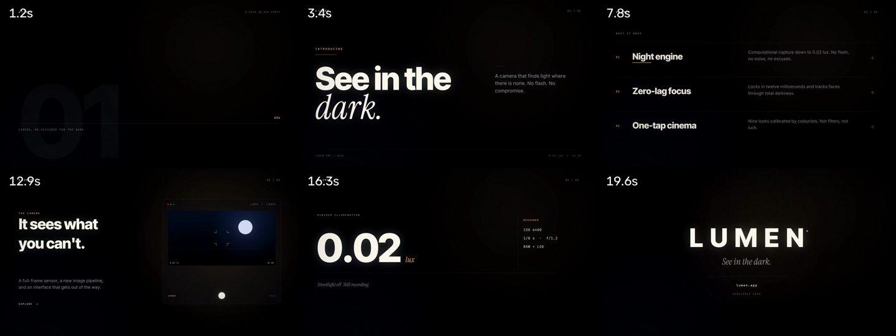

# cutwright

Deterministic launch films and footage edits, rendered on CPU, with no browser,
no GPU, no API keys and no per-render cost.

```bash
cw launch --spec examples/lumen.json --out out/lumen.mp4   # 21s brand film, 1080p30
cw edit raw/*.mp4 -o out/cut.mp4 --target 30               # remove dead air, tighten, master
```



## Demos (rendered from this repo)

| File | What it is | Spec |
|---|---|---|
| [lumen-1080.mp4](docs/demos/lumen-1080.mp4) | 21 s launch film, six scenes, synthesised score | 1920×1080 · 30 fps · 630 frames |
| [hyper-1080.mp4](docs/demos/hyper-1080.mp4) | 9.5 s 3D sting: grid, fly-in, four beat-locked cards | 1920×1080 · 120 BPM · 285 frames |
| [edit-demo.mp4](docs/demos/edit-demo.mp4) | three source clips cut to 11.07 s — silences removed, single encode | 5 segments · mastered |
| [beatcut.mp4](docs/demos/beatcut.mp4) | 12 shots cut on a 129 BPM grid | 11.15 s · beat montage |

Both pass `cw qc` (dead air, freezes, −14 LUFS, true peak, exact frame count).

---

## Why this exists

I audited the DeepSeek Harness video-plugin ecosystem (DirectorX, dsh-media-gen,
dsh-videogen, yingliu-video-studio, dsh-genbox, HyperFrames, dsh-hyperframes)
before writing a line of this. The finding was consistent: **most plugins sell
provider plumbing, not pixels.**

| Project | What it contributes locally | Cost model | The catch |
|---|---|---|---|
| dsh-media-gen | nothing — no ffmpeg call anywhere | paid vendor APIs | 100% of the cost, 0% of the render |
| dsh-videogen | thin ffmpeg wrappers at `veryfast`/CRF 23 | paid vendor APIs | not installable as shipped (no `lib/`, not on npm) |
| DirectorX | real timeline: trims, xfade, ducking, 16 grades | free editing, optional gen | 147 MB, 153 tools, `veryfast` + default CRF on every pass |
| yingliu-video-studio | Chrome frame capture + CRF 16/18 + limiter | free | GPL-3.0, Desktop-leaning, no motion blur |
| HyperFrames | best-in-class HTML→MP4, real motion blur, BeginFrame seek | free locally | Chromium + 15 system libs, not an NLE |
| **cutwright** | **motion engine + footage EDL + QC, all local** | **free** | younger than the above; 16:9 launch layouts |

HyperFrames is genuinely good engineering, and if you want to author in HTML it
is the right tool. It is also a compositor, not an editor: it will not find the
dead air in a two-hour interview, and its quality ceiling is still set by the
HTML someone writes. cutwright takes the other side of that trade: a small,
deterministic, frame-accurate engine that owns both motion design and
footage cutting, and refuses to emit a file that fails its own QC.

## What makes the output look expensive

Not filters. These:

1. **Real shutter sampling.** Every frame is the average of 3 sub-frames across
   a 180° shutter. Text, cards and UI get true motion blur instead of a
   CSS `filter: blur()` approximation — and samples are clamped to the current
   scene, so a cut never ghosts two shots together.
2. **A type system, not a font.** Inter Tight / Inter / Instrument Serif Italic /
   JetBrains Mono, instantiated as static weights, with an optical scale per
   role, `-0.028em` display tracking, `0.22em` mono labels, and masked
   bottom-up reveals on an expo curve.
3. **An edit rhythm.** Every hard cut lands on a composed frame — entrances are
   timed so the first frame after a cut already carries the kicker or the
   headline. (The first cut of this film failed its own black-frame QC for
   exactly 0.3 s per cut; that is what QC is for.)
4. **Finishing.** Filmic tone curve, threshold bloom, vignette, 4-bit dithering
   grain applied in-loop at encode. Dark gradients are where amateur renders
   band; grain and `aq-mode=3` are why these do not.
5. **Sound design as a first-class layer.** Whooshes, impacts, risers and ticks
   are synthesised with numpy and placed on exact frames, then mastered to
   −14 LUFS / −1.5 dBTP. No sample licences, no third-party music.
6. **Real 3D, not `rotateY`.** `threed.py` projects geometry itself: perspective
   planes, flat-shaded meshes, floor grids and — the useful trick — *vector text
   drawn through a projective matrix*, so type stays sharp in depth while the
   camera moves. No browser, no GPU, no GL context.
7. **Cuts on the beat.** `beats.py` finds tempo with spectral flux and
   autocorrelation, then fits `t_i = a + i·T` by least squares over every onset
   (a comb grid put a 128 BPM click at 129.2; the fit put it at 128.18).
8. **Quality gates.** `cw qc` checks dimensions, exact duration, mid-roll black
   spans (head/tail fades are allowed), freezes, integrated loudness, true peak
   and file weight. A render that fails is not a deliverable.

## Install

Requires Python 3.10+, ffmpeg with libx264, and ~200 MB of disk.

```bash
# ffmpeg (static build, no root)
curl -sL -o /tmp/ffmpeg.tar.xz \
  https://github.com/BtbN/FFmpeg-Builds/releases/download/latest/ffmpeg-master-latest-linux64-gpl.tar.xz
tar -xJf /tmp/ffmpeg.tar.xz -C /tmp && mkdir -p ~/.local/bin
cp /tmp/ffmpeg-*/bin/ffmpeg /tmp/ffmpeg-*/bin/ffprobe ~/.local/bin/

# fonts (Inter, Inter Tight, Instrument Serif, JetBrains Mono, Sora, Space Grotesk)
cw fonts   # verifies the stack; see src/cutwright/fonts.py for the expected paths

pip install -e .
cw doctor
```

`skia-python` needs `libEGL.so.1` / `libGL.so.1` on the host. On a slim image
without root, extract them locally and export `LD_LIBRARY_PATH`; on Debian/Ubuntu
with root, `apt install libegl1 libgl1`. `cw doctor` reports the rest.

## Use

### Launch film

```bash
cw launch --spec examples/lumen.json --out out/lumen.mp4 \
          --crf 16 --motion-blur 3 --preset medium
```

The spec is plain JSON — brand, copy, three features, proof number, end card,
palette. Six scenes are fixed; the writing is not:

```json
{
  "name": "LUMEN",
  "kicker": "INTRODUCING",
  "hero_a": "See in the",
  "hero_b": "dark.",
  "features": [["Night engine", "Computational capture down to 0.02 lux."]],
  "stat_value": 0.02, "stat_unit": "lux",
  "accent": "#FFB26B", "accent2": "#6C7BFF"
}
```

Stills for review, without encoding a full film:

```bash
cw launch --spec examples/lumen.json --still 3.3,7.4,12.6,19.4 --out out/frame.png
```

### 3D sting

```bash
cw hyper --out out/hyper.mp4
```

Nine and a half seconds at 120 BPM: a grid floor rushing to a vanishing point, a
camera fly-in that lands on a 3D wordmark, four beat-locked cards, then the mark
again in perspective with a synthesised score hit on every beat.

### Beat cuts

```bash
cw beats track.mp3                      # tempo + first beats, no dependencies
cw edit a.mp4 b.mov -o out/montage.mp4 --beats track.mp3 --cut-every 2
```

The second command cuts the montage on the music's beat grid instead of on
silence, one shot every two beats, cycling sources.

### Footage

```bash
cw edit interview.mp4 broll/*.mov -o out/cut.mp4 --target 45 --vertical
```

What it does: probes every source, detects silences (−32 dB, ≥0.35 s), keeps
the speech with 70 ms handles, drops clips under 450 ms, optionally caps the cut
at `--target`, reframes to 1080×1920, concatenates in a **single** ffmpeg pass
(one encode, no generations), normalises to −14 LUFS, and writes
`out/cut.plan.json` so the edit is reproducible.

```bash
cw probe raw.mp4
cw qc out/cut.mp4 --expect '{"width":1080,"height":1920,"loudness":-14}'
```

## Measured on this box (2 vCPU, 1.9 GB RAM, no GPU)

| Stage | Cost |
|---|---|
| Skia draw, 1080p, one full comp frame | ~44 ms |
| Finishing chain (grade+bloom+chromatic+vignette) | ~31 ms |
| 21 s film, 630 frames × 3 sub-frames, CRF 16 | **166 s** (7.9× real-time for 1080p30) |
| Output | 1080p30 H.264 High, ≈11 Mbps at CRF 16, 29 MB |
| 3D sting (HYPERCUT), 285 frames × 3 sub-frames | 560 s — grid + streaks + perspective text are the cost |
| Footage auto-edit (18 s → 11.07 s) | 38 s |
| Beat montage (26 beats → 12 shots, 11.15 s) | 44 s |
| UI-only frame (no footage) | ~5 ms |

The whole 21 s master is cheaper than one 5 s clip from a hosted video model
($0.25–$2.50 at Nov 2026 list prices), and it is re-renderable byte-for-byte
from the spec.

## Layout

```
src/cutwright/
  comps.py     six-scene launch film, all motion as a function of t
  raster.py    Skia drawing surface + typography (tracking, wrapping, masks)
  motion.py    easing, springs, stagger, mask reveals
  fx.py        LUT grade, bloom, vignette, grain bank (8-bit, ~30 ms/frame)
  audio.py     numpy synthesis: whoosh, impact, riser, tick, drone
  render.py    frame loop, shutter sampling, x264 encode, loudness mux
  edit.py      silence→EDL, single-pass concat, reframe
  analyze.py   silencedetect, scene score, ebur128, face position
  qc.py        black/freeze/loudness/spec gates
  cli.py       cw doctor | launch | edit | probe | qc | fonts
```

## Limits, stated

- Launch layouts are composed for 16:9. `cw edit --vertical` is real; a
  vertical *launch* composition is not written yet.
- No ASR captions. `cw edit` masters audio but does not transcribe it.
- The soundtrack is synthesised, deliberately minimal. A licensed track will
  always beat it for brand work; the point is that the tool needs no licence to
  produce a finished film.
- Everything is CPU. On 2 cores a 21 s film takes ~3 minutes; on a normal
  workstation it is under a minute.

Want this on another machine, with the rendering in an E2B cloud sandbox driven by opencode?
Paste [docs/BOOTSTRAP-PROMPT.md](docs/BOOTSTRAP-PROMPT.md) into a coding agent and fill one key.

The full evidence behind these choices — plugin audit, skill installs, filter
benchmarks, 3D feasibility — is in [docs/RESEARCH.md](docs/RESEARCH.md).

MIT.
